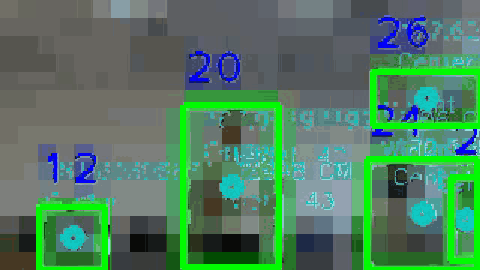
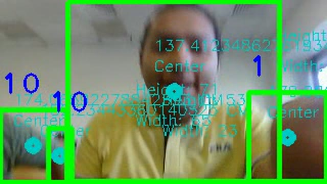
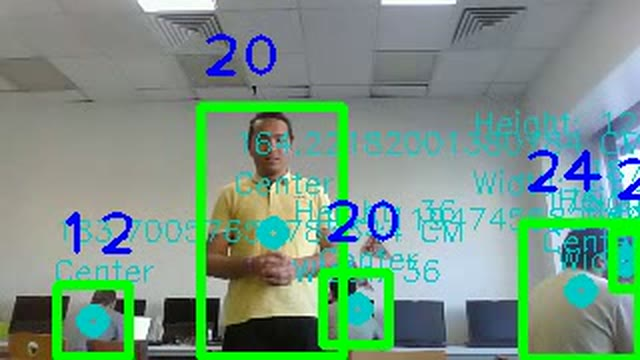
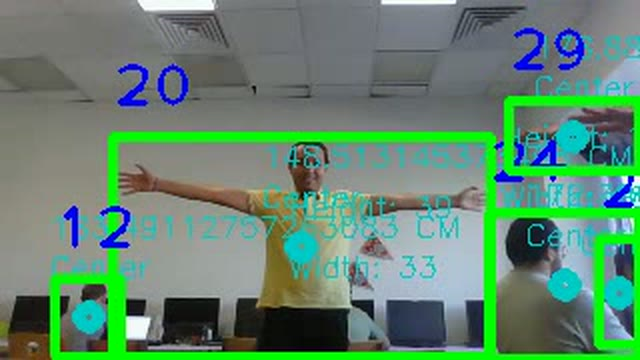
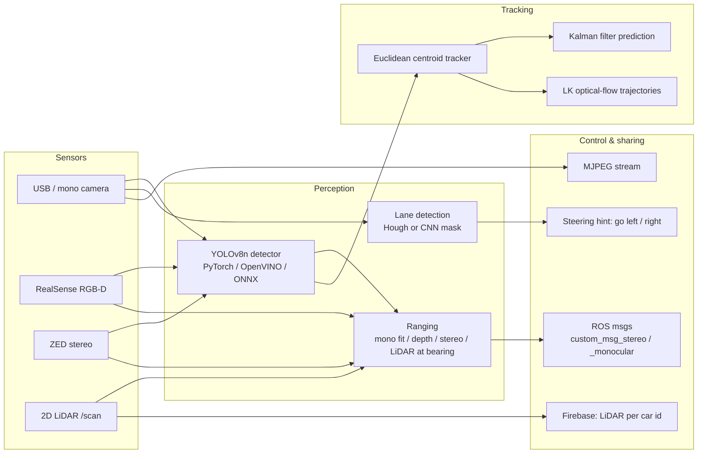
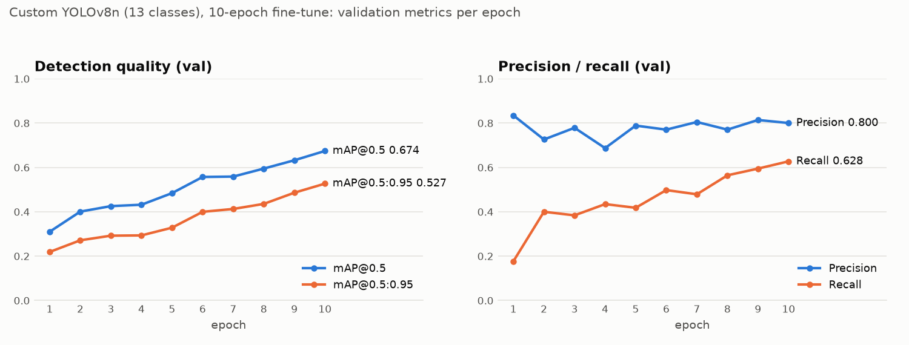
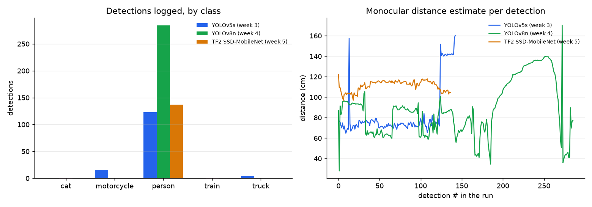

# CPAC: perception for connected autonomous vehicles

**Real-time road-obstacle detection, multi-object tracking, motion prediction, lane following and
camera/LiDAR/stereo ranging on ROS 1, built for a cooperative-perception car.**
Bachelor project *Cooperative Perception and Control for Connected Vehicles* (2024).

**▶ Demo:** the fine-tuned detector runs entirely in the browser (ONNX Runtime Web, no server); see [`demo/`](demo) and *Demo locally* below. The GitHub Pages deployment is coming soon.


[](LICENSE)



<sub>The project's own recording: YOLOv8n (OpenVINO) detections with Euclidean-tracker IDs (blue), box
centres and distance read-outs, straight from the pipeline. Shown with the consent of the people in it.</sub>

| Close-range detection | Track IDs over time | Multiple tracked people |
|---|---|---|
|  |  |  |

## What it does

* **Detects** 13 road-obstacle classes (person, bicycle, car, motorcycle, bus, train, truck, traffic
  light, stop sign, cat, dog, fence, cone) with a YOLOv5s / YOLOv8n fine-tuned on a Roboflow dataset,
  compared with a TF2 SSD-MobileNetV2 model and accelerated on CPU with **OpenVINO**.
* **Tracks** every person with a centroid tracker (persistent IDs), **predicts** motion with a
  Kalman filter and draws **Lucas–Kanade optical-flow** trajectories.
* **Ranges** each object three ways: a calibrated monocular box-size fit, **RGB-D depth** (Intel
  RealSense) or the **ZED stereo** point cloud, and **camera + 2D LiDAR fusion** (the LiDAR range at
  the object's camera bearing).
* **Follows lanes** with a classical OpenCV pipeline (Canny, ROI, Hough) and a CNN segmentation
  model that turns the lane centre into a steering hint.
* **Shares** what it sees: ROS custom messages (`object, timestamp, distance, angle`), an MJPEG
  stream of the camera, and LiDAR scans pushed to Firebase per car id for other vehicles and a
  dashboard.

## Architecture



All camera nodes talk over ROS 1 topics (`video_topic`, `color_video_topic`, `depth_video_topic`,
`depth_array_topic`, `/scan`). The detection nodes publish one message per detected object.

## Modules

| Folder | What is inside | Key files |
|---|---|---|
| [`detection/`](detection) | YOLOv5s / YOLOv8n inference with monocular distance + CSV logging, OpenVINO runner, TF2 SSD comparison, CPU benchmark | `yolov8_detect_distance.py`, `yolov8n_openvino_detect.py`, `benchmark_fps.py`, `tf2/` |
| [`tracking/`](tracking) | Centroid tracker, Kalman filter, optical flow, two-camera matching | `tracker.py`, `kalmanfilter.py`, `track_kalman_optical_flow.py` |
| [`lane_detection/`](lane_detection) | Canny + Hough lanes; CNN lane mask → steering hint; Colab notebook | `lane_opencv_hough.py`, `lane_cnn_steering.py` |
| [`sensors/`](sensors) | RealSense depth, ZED stereo distance and angle, LiDAR plotter, LiDAR → Firebase | `zed_detect_distance.py`, `realsense_detect_track.py`, `lidar_*.py` |
| [`ros/ros_opencv/`](ros/ros_opencv) | Catkin package: camera publishers, detection and lane nodes, custom msgs, MJPEG server | `scripts/Camera_detection*.py`, `msg/*.msg` |
| [`demo/`](demo) | Static browser demo (ONNX Runtime Web), deployed to GitHub Pages | `index.html`, `app.js` |
| [`space/`](space) | Gradio app, ready for a Hugging Face Space | `app.py` |
| [`docs/`](docs) | Week-by-week project log, known issues, figures | `project-log.md` |

## Results

Only numbers that exist in the project artefacts, or that were measured again for this repo, are
reported here. Each row says where it comes from.

### Detection quality: custom YOLOv8n (13 classes)

| Metric (validation split, final epoch) | Value |
|---|---|
| Precision | **0.800** |
| Recall | **0.628** |
| mAP@0.5 | **0.674** |
| mAP@0.5:0.95 | **0.527** |

*Source:* `train_metrics` stored inside `yolov8n_custom_last.pt` (Ultralytics 8.1.27, trained
2024-03-14). Setup: fine-tuned from COCO `yolov8n.pt` for **10 epochs**, imgsz 640, batch 16,
mosaic off. The per-epoch curves below come from the same checkpoint (`train_results`). mAP was
still rising at epoch 10, so the model was under-trained.



The YOLOv5s model (`yolov5s_custom_last.pt`, 8 epochs, batch 8, from `yolov5s.pt`) and the TF2
SSD-MobileNetV2 (ckpt-51) stored **no** evaluation metrics, and none appear in the reports.

### CPU speed: PyTorch vs ONNX Runtime vs OpenVINO (measured now)

| Backend (same custom YOLOv8n) | FPS, end-to-end | Inference, median ms |
|---|---|---|
| PyTorch (`.pt`) | 29.9 | 30.7 |
| ONNX Runtime 1.31 (`.onnx`) | 25.8 | 32.4 |
| **OpenVINO 2026.4** (IR) | **39.4** | **21.3** |

*Measured* on 2026-11-09 with [`detection/benchmark_fps.py`](detection/benchmark_fps.py). Setup:
AMD Ryzen 7 7435HS (8 cores / 16 threads), 16 GB RAM, Windows 11, CPU only; torch 2.15, Ultralytics
8.4.208; 100 frames of the project's 320×180 recording after 10 warm-up frames; imgsz 640; median of
3 runs. OpenVINO is **~1.3× faster than PyTorch** even though the exports run a fixed 640×640 input
while PyTorch letterboxes to 640×384. The original weekly reports printed FPS live but never
recorded the values.

### Generalisation check: a limitation found while building the demo

On 7 public-domain street photos from Wikimedia Commons (no labels, so these are counts, not
accuracy, at conf 0.15), the fine-tuned model found far fewer objects than the stock COCO YOLOv8n.
On a busy motorway it found 5 cars where the baseline found 41 cars and 6 trucks. It also predicted
a spurious **`train`** in 4 of the 7 photos. A small dataset, 10 epochs and full fine-tuning likely
cost much of the COCO knowledge (catastrophic forgetting). The browser demo in [`demo/`](demo)
lets you compare the two models on any image.

### Detection logs from the weekly test runs

During weeks 3–5 each detector logged every detection to a CSV file: class, box corners, size,
centre, and the **monocular distance estimate** worked out from the box size. These are the
project's original logs, unchanged, in [`docs/detection-logs/`](docs/detection-logs/).



| Run (log file) | Detections | Classes logged | Distance estimate, median (range) |
|---|---|---|---|
| YOLOv5s, week 3 ([csv](docs/detection-logs/yolov5_outputs.csv)) | 143 | person 123, motorcycle 16, truck 4 | 74 cm (65–160) |
| YOLOv8n, week 4 ([csv](docs/detection-logs/yolov8_outputs.csv)) | 286 | person 284, train 1, cat 1 | 87 cm (28–170) |
| TF2 SSD-MobileNet, week 5 ([csv](docs/detection-logs/tf2_ssd_outputs.csv)) | 137 | person 137 | 113 cm (97–122) |

Each run is a **separate recording**, so this isn't a head-to-head accuracy comparison. What the logs
do show:
- the full pipeline worked end to end: detect → measure the box → estimate the distance → log;
- the distance estimate tracks a person stepping closer and further away (YOLOv8n, detections ~150–270);
- one-off false classes ("train", "cat") match the false "train" seen in the check above.

### Not measured: experiments to rerun

* **Held-out test mAP** for YOLOv5s, YOLOv8n and SSD on the Roboflow split (`model.val(split="test")`);
  the dataset is not in this repo, so download it from Roboflow (link below).
* **Longer training / partial freezing** (e.g. 50–100 epochs, `freeze=10`, mosaic on) to fix the
  generalisation gap above.
* **Lane detection:** IoU of the CNN mask and lateral-offset error on labelled frames. No lane
  metric was ever recorded.
* **Ranging error** of each method (monocular fit, RealSense, ZED, LiDAR-at-bearing) against
  tape-measured distances.
* **Tracking:** ID switches / MOTA on an annotated clip.

## Model card: custom YOLOv8n

| | |
|---|---|
| **Task** | 2D object detection, 13 classes: person, bicycle, car, motorcycle, bus, train, truck, traffic light, stop sign, cat, dog, fence, cone |
| **Base model** | Ultralytics YOLOv8n pretrained on COCO, fully fine-tuned |
| **Data** | Roboflow Universe [“car-obsticles” v1](https://universe.roboflow.com/yolov5-euqqq/car-obsticles/dataset/1), CC BY 4.0 |
| **Training** | 10 epochs, 640 px, batch 16, SGD (auto), mosaic off, Ultralytics 8.1.27 |
| **Metrics** | val P 0.800 · R 0.628 · mAP@0.5 0.674 · mAP@0.5:0.95 0.527 (see Results) |
| **Formats** | PyTorch `.pt` (6 MB), ONNX opset 12 (12 MB), OpenVINO IR, all in [Release v1.0.0](https://github.com/Nardy11/cpac-autonomous-perception/releases/tag/v1.0.0) |
| **Intended use** | Research and teaching: indoor / campus test drives of a small robot car, CPU-only edge boards |
| **Out of scope** | Any safety-critical driving decision. The model is under-trained, generalises poorly to unseen street scenes, and its monocular distance is only calibrated for 40–80 cm with one webcam |
| **Licence** | Ultralytics AGPL-3.0 (weights); dataset CC BY 4.0 |

The release also holds the **stock COCO YOLOv8n** (`yolov8n_coco*`, Ultralytics, AGPL-3.0) as a
baseline and as the model most tracking and ROS scripts load. It is not a model trained in this
project.

## How to run

```bash
git clone https://github.com/Nardy11/cpac-autonomous-perception && cd cpac-autonomous-perception
pip install -r requirements.txt
mkdir weights && gh release download v1.0.0 -D weights   # or download the assets from the Release page
```

**Detection** (webcam `--source 0` or a video path):

```bash
python detection/yolov8_detect_distance.py --weights weights/yolov8n_custom_last.pt --source 0
python detection/yolov5_detect_distance.py --weights weights/yolov5s_custom_last.pt --source road.mp4
python detection/yolov8n_openvino_detect.py --source road.mp4          # exports yolov8n to OpenVINO first
python detection/benchmark_fps.py --video weights/detection_tracking_demo.mp4 \
  --models weights/yolov8n_custom_last.pt weights/yolov8n_custom_last.onnx weights/yolov8n_custom_last_openvino_model
python detection/tf2/ssd_mobilenet_webcam.py --tfod-root /path/to/Tensorflow   # needs the TF Object Detection API
```

**Tracking and prediction** (run from `tracking/`, so `tracker.py` and `kalmanfilter.py` import):

```bash
cd tracking
python track_euclidean_openvino.py --source 0
python track_kalman_optical_flow.py --source road.mp4
```

**Lane detection:**

```bash
python lane_detection/lane_opencv_hough.py --video road.mp4
python lane_detection/lane_cnn_steering.py --model weights/lane_cnn_model.h5 --video road.mp4   # needs tensorflow
```

**Sensors** (hardware SDKs required):

```bash
python sensors/realsense_view.py                 # pyrealsense2
python sensors/zed_detect_distance.py            # ZED SDK + pyzed
python sensors/lidar_visualizer.py               # ROS + pygame, subscribes to /scan
FIREBASE_CREDENTIALS=/path/key.json FIREBASE_DB_URL=https://<project>-default-rtdb.firebaseio.com/ CAR_ID=1 \
  python sensors/lidar_firebase_sender.py
```

**ROS 1 (Noetic):** copy `ros/ros_opencv` into `~/catkin_ws/src`, then:

```bash
catkin_make && source devel/setup.bash
rosrun ros_opencv camera_publisher.py          # RealSense colour + depth topics
rosrun ros_opencv Camera_detection.py          # detection + depth + bearing -> custom_msg_stereo
rosrun ros_opencv camera_pub_mono.py           # USB camera -> video_topic
rosrun ros_opencv Camera_detection_mono.py     # detection + LiDAR range at bearing -> custom_msg_monocular
LANE_MODEL=/path/lane_cnn_model.h5 rosrun ros_opencv camera_LaneDetection_mono.py
```

**Demo locally:** put `yolov8n_custom.onnx` and `yolov8n_coco.onnx` in `demo/model/`, then run
`python -m http.server -d demo`.

## Release assets (v1.0.0)

| File | What |
|---|---|
| `yolov8n_custom_last.pt` / `.onnx` / `_openvino_model.zip` | Custom 13-class YOLOv8n and its exports |
| `yolov5s_custom_last.pt` | Custom 13-class YOLOv5s (load with `torch.hub.load('ultralytics/yolov5', 'custom', ...)`) |
| `yolov8n_coco.pt` / `.onnx`, `yolov8n_coco_openvino_model.zip` | Stock Ultralytics COCO YOLOv8n (baseline; the OpenVINO IR is the one the project used) |
| `lane_cnn_model.h5` | Keras lane-segmentation model used by the lane scripts (160×80 input) |
| `detection_tracking_demo.mp4` | Full 2 min test recording of detection + tracking (640×360, H.264) |

## My role

I'm **Nardy Michelle**. I wrote the code in this repository during the project and authored the weekly
progress reports. Week by week, my work covered:

* training and comparing the detectors (YOLOv5s, YOLOv8n, TF2 SSD-MobileNetV2) on the 13-class dataset;
* the monocular distance calibration, CSV logging and FPS measurement;
* the OpenVINO export for CPU inference;
* integrating tracking, Kalman prediction and optical flow;
* both lane-detection pipelines and the steering hint;
* the ROS 1 package: publishers, detection and lane nodes, custom messages;
* RealSense / ZED ranging and camera–LiDAR fusion by bearing;
* the LiDAR → Firebase sender for vehicle-to-cloud sharing.

The full timeline is in [`docs/project-log.md`](docs/project-log.md).

**Team and credits**

* The CPAC bachelor-project team. The original team repository is maintained by
  [alielbadawy](https://github.com/alielbadawy).
* Training data: Roboflow Universe *car-obsticles* (CC BY 4.0).
* Detectors: [Ultralytics YOLOv5 / YOLOv8](https://github.com/ultralytics/ultralytics) (AGPL-3.0).
* `EuclideanDistTracker` and the OpenCV Kalman-filter wrapper follow the
  [Pysource](https://pysource.com/2021/10/29/kalman-filter-predict-the-trajectory-of-an-object/) tutorials.
* The CNN lane-inference code (`road_lines`, averaged lane mask) follows Michael Virgo's
  [MLND-Capstone](https://github.com/mvirgo/MLND-Capstone) lane-detection project.
* Demo photos: Wikimedia Commons, CC0 / public domain (credited on the demo page).

## Licence

The code is MIT ([LICENSE](LICENSE)). The model weights in the release are Ultralytics-derived and
licensed **AGPL-3.0**. The dataset is CC BY 4.0. Personal paths and credentials from the original
lab machines were replaced with CLI flags and environment variables; never commit a service-account key.
